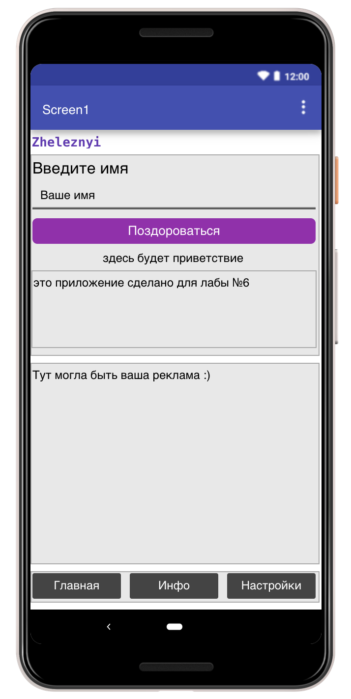
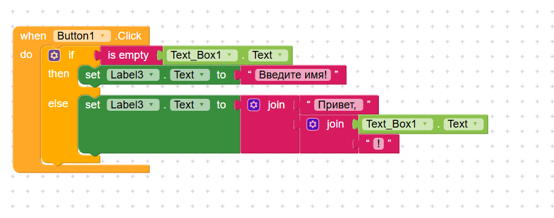

# Лабораторная работа №6 (Kodular)

Базовое задание: Приложение «Приветствие»

**Реализованный функционал:**

Создан первый экран приложения, содержащий обязательные элементы: заголовок «Введите имя», текстовое поле (TextBox) с подсказкой «Ваше имя», кнопку «Поздороваться» и лейбл для вывода результата. В верхней части экрана размещен лейбл с фамилией на английском языке — **Zheleznyi**.

**Логика работы (Блоки):**

При нажатии на кнопку срабатывает условный оператор `if`. С помощью блока `is empty` проверяется, пустое ли текстовое поле:

- Если поле пустое, в нижний лейбл выводится текст «Введите имя!».
- Если поле заполнено, с помощью блока `join` формируется приветствие: «Привет, » + введенное имя + «!».

**Скриншоты базовой части:**

---
 Выводы

В ходе выполнения лабораторной работы я познакомилась с платформой визуального программирования Kodular. Настроила интерфейс приложения, использовала макеты для структурирования элементов и реализовала логику с помощью визуальных блоков.

В базовой части было создано приложение «Приветствие».

В результате работы были освоены основные компоненты Kodular, принципы обработки событий, условные конструкции и управление видимостью элементов интерфейса.
